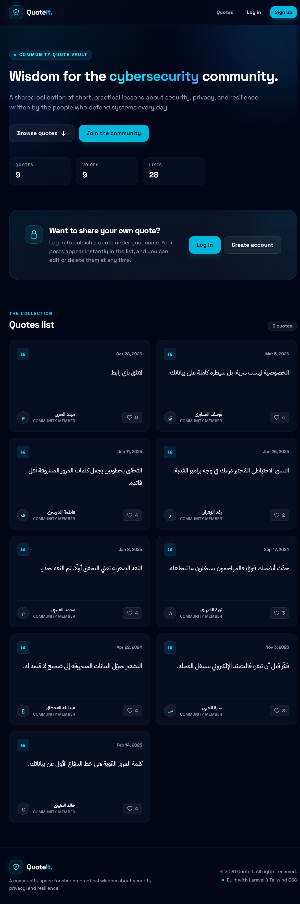
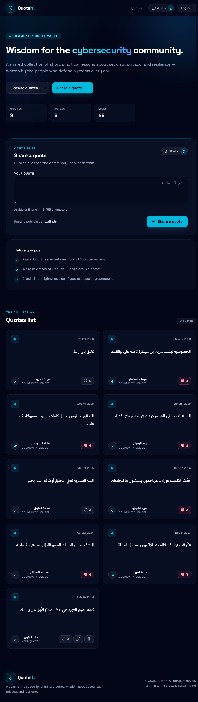

# QuoteIt 🛡️

**A community platform for sharing cybersecurity quotes — dark-themed, bilingual (Arabic/English), and fully responsive.**

[](https://quoteit.noufcode.workers.dev)
[](https://laravel.com)
[](https://php.net)
[](https://tailwindcss.com)
[](https://workers.cloudflare.com)
[](LICENSE)

---

## 🔗 Try it live

**Website:** https://quoteit.noufcode.workers.dev

> Demo credentials are shared separately with reviewers.

> The site is deployed on **Cloudflare Workers + D1** and runs on a permanent free HTTPS URL.

---

## 📸 Screenshots

### Home page — guest


### Home page — signed-in member


### Project demo video
[`docs/QuoteIt_Demo.mp4`](docs/QuoteIt_Demo.mp4) — a full walkthrough of the site (sign up, publish, edit, delete, like).

---

## 💡 About the project

**QuoteIt** is a shared space where the cybersecurity community collects short, practical
lessons about security, privacy, and resilience. Visitors can browse every published quote,
while registered members can publish their own quotes and manage them completely.

The project was built as the final project for **Al-Qimmah Bootcamp**. It implements all
functional and non-functional requirements and adds a new feature: **likes with persistent
counts stored in the database**.

---

## ✨ Features

| Feature | Details |
| --- | --- |
| 📖 Public feed | Every quote is visible to guests: text, author, date, and like count |
| 🌍 Arabic support | Automatic RTL detection with a dedicated Arabic font and alignment |
| 👤 Sign up | Full validation: name 2–50 chars, valid unique email, password ≥ 8 chars with confirmation |
| 🔐 Authentication | Secure login/logout with session regeneration on sign-in |
| ✍️ Publish quotes | 3–155 characters, with field hints and inline validation errors |
| 🛠️ Owner controls | Only the author can edit or delete a quote; everyone else gets **403** |
| ❤️ Likes | Toggle like/unlike with the count persisted in the database |
| 🎨 Responsive UI | Fully dark design, mobile-first, respects reduced-motion preferences |
| ♿ Accessibility | Skip-to-content link, ARIA labels, and accessible color contrast |

---

## 🏗️ How it works

The project ships in two equivalent flavours — identical UI and behaviour:

### 1) Original app — Laravel
- PHP 8.3 + Laravel 13 with **Blade** templates and reusable components.
- **Eloquent + SQLite** (`database/database.sqlite`) with seeded demo data.
- Laravel sessions, CSRF protection, and the `hashed` cast for passwords.
- Tailwind CSS 4 compiled through Vite.

### 2) Deployed app — Cloudflare Worker + D1
Because Cloudflare Containers require a paid plan, the backend was rebuilt in **TypeScript**
on a Worker with a **D1** database, while keeping the exact same HTML, design, and data:

```
Browser
   │
   ▼
Cloudflare Worker (src/index.ts)
   ├── routing + CSRF verification
   ├── HMAC-signed session cookie (HttpOnly)
   ├── PBKDF2-SHA256 password hashing
   └── D1 queries (users / quotes / quote_likes)
          │
          ▼
     D1 Database (SQLite)
```

- **Session:** a `quoteit_session` cookie holding `{uid, csrf, exp}`, signed with HMAC-SHA256.
- **Flash messages:** a short-lived `quoteit_flash` cookie for status messages and validation errors.
- **Passwords:** `pbkdf2$10000$salt$hash` (PBKDF2-SHA256), since bcrypt is impractical on the free plan.
- **Static assets:** CSS and `robots.txt` served through **Workers Static Assets**.

---

## 🧰 Tech stack

| Layer | Laravel app | Cloudflare app |
| --- | --- | --- |
| Frontend | Blade + Tailwind CSS 4 + Vite | Same HTML/CSS |
| Backend | PHP 8.3 / Laravel 13 | TypeScript on Workers |
| Database | SQLite + Eloquent | D1 (SQLite) |
| Sessions | Laravel Session | HMAC-signed cookie |
| Hosting | `php artisan serve` / any PHP host | `wrangler deploy` |

---

## 📁 Project structure

```
quoteit/
├── app/                        # Controllers & models (Laravel)
│   ├── Http/Controllers/       # Auth, Quote, Like
│   └── Models/                 # User, Quote
├── resources/
│   ├── css/app.css             # Tailwind + fonts
│   └── views/                  # Blade templates & components
├── routes/web.php              # Application routes
├── database/
│   ├── migrations/
│   ├── seeders/                # 8 users + 8 quotes
│   └── database.sqlite         # Created locally via migrate --seed (not committed)
├── cloudflare/                 # Cloudflare deployment
│   ├── src/index.ts            # Router + auth + D1
│   ├── src/templates.ts        # Blade-equivalent HTML
│   ├── schema.sql
│   ├── seed.sql
│   ├── public/                 # Compiled CSS + robots.txt
│   └── wrangler.jsonc
├── docs/
│   ├── screenshots/
│   ├── QuoteIt_Demo.mp4
│   └── DEMO_SCRIPT.md
└── README.md
```

---

## 🚀 Run locally (Laravel)

**Requirements:** PHP 8.3+, Composer, Node.js 20+

```bash
composer install
cp .env.example .env
php artisan key:generate
php artisan migrate --seed
npm install
npm run build
php artisan serve
```

Then open http://127.0.0.1:8000

**Reset the demo data at any time:**

```bash
php artisan migrate:fresh --seed
```

---

## ☁️ Deploy to Cloudflare

```bash
cd cloudflare

# First time only
npx wrangler d1 create quoteit-db
# Put the returned database_id into wrangler.jsonc
npx wrangler d1 execute quoteit-db --remote --file=./schema.sql --yes
npx wrangler d1 execute quoteit-db --remote --file=./seed.sql --yes
npx wrangler secret put SESSION_SECRET

# Deploy
npx wrangler deploy
```

Local development on the Workers runtime:

```bash
cd cloudflare
npx wrangler dev
```

More details in [`cloudflare/README.md`](cloudflare/README.md).

---

## 🔒 Security

- ✅ CSRF protection on every `POST` request (per-session token, constant-time comparison).
- ✅ `HttpOnly` + `Secure` + `SameSite=Lax` cookies; sessions signed with HMAC.
- ✅ Passwords hashed with PBKDF2-SHA256 using a random per-user salt.
- ✅ Output escaping for all user input to prevent XSS.
- ✅ Ownership checks before edit/delete, returning 403 for other users.
- ✅ D1 queries use bound parameters to prevent SQL injection.
- ✅ `.env`, `vendor/`, `node_modules/`, and local databases are never committed.

---

## 👩‍💻 Author

**Nouf** — [@Nouf-20](https://github.com/Nouf-20)

---

## 📄 License

This project is licensed under the [MIT License](LICENSE).
